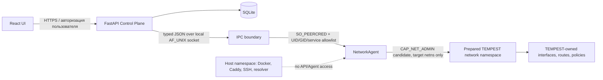

# NetworkPlan, NetworkAgent и IPC — задачи 2.1–2.3

**Статус:** задачи 2.1 и 2.2 приняты владельцем; задача 2.3 `IN_PROGRESS`, [карта вызовов](TASK_2_3_CALL_MAP.md). Самостоятельный AF_UNIX сервис пока исполняет только in-memory no-op/mock state machine и не меняет сеть. Control Plane в новом opt-in Agent mode может вызвать только типизированные validate/diff/status; mock apply не выдаётся за сетевой успех. ADR-001 остаётся `PROPOSED`; этап 2 `IN_PROGRESS`; задачи 2.4–2.8 не начинались.

## Граница полномочий

- **Control Plane:** FastAPI, React, SQLite and pure plan generation. Unprivileged UID; no Linux capabilities, host PID/network, Docker socket, system mounts or direct `ip`/`nft`/`nsenter` execution.
- **Preferred experiment (A):** separate Agent/dataplane process in a pre-created dedicated network namespace. Agent can be considered for `CAP_NET_ADMIN` in that target only after checking the governing user namespace and service capability set. It does not create or join namespaces itself and has no `CAP_SYS_ADMIN`.
- **Fallback experiment (B):** a restricted systemd service in the host network namespace, only if A cannot perform a demonstrated host-only operation. `CAP_NET_ADMIN` there can affect the VM's whole host namespace, regardless of the service UID, so B is strictly a disposable-VM experiment.
- PiTun's production privilege model is not inherited. Global default route, system resolver, foreign firewall state, Docker API and router/Wi-Fi/DHCP operations are outside this contract.

## Contract v1

Implementation: `backend/app/network_agent/models.py`; privilege-free state machine: `backend/app/network_agent/mock.py`.

`NetworkPlan` is strict immutable JSON with `schema_version=1`, UUID `generation_id`, monotonic positive `generation`, compare-and-swap `base_generation`, explicit `target_namespace_id`, enabled egress candidates, selected default egress, explicit DIRECT permission, confirmation timeout, and a complete desired-state tuple of typed operations. Canonical sorted JSON yields a SHA-256 fingerprint. The wire fields and IPC protocol version remain v1; this change tightens semantic validation using existing operation types, so there is no schema-version bump. A v1 plan without the required deny policy is now invalid and must be regenerated before staging.

V1 typed intents are `ensure_interface`, `assign_address`, `ensure_route`, and `set_egress_policy`. Each operation carries an owner literal `tempest` and a namespaced `tempest-*` object ID; interfaces must target the plan's pre-existing `tempest-ns-*` namespace. Routes and allow policies must reference enabled egress candidates, and each allow policy must have a route for that same egress. Every plan must include a `set_egress_policy` block for `protected_ingress`; that operation is the mandatory default-deny baseline, while allow policies are explicit exceptions. Unknown discriminators/fields, malformed IP/CIDR values, duplicate object IDs, namespace escape, a missing baseline block, unapproved DIRECT and missing/disabled egress are rejected. There is no free-form shell, nftables program, file path, environment, or systemd argument.

### Fail-closed invariant for protected ingress

The contract chooses a mandatory `NetworkPlan` policy rather than relying on an implicit property of a future Agent. Protected ingress is denied by default, including in a newly prepared namespace before any accepted plan exists. A plan cannot describe protected ingress without an explicit block policy, and cannot describe an allow unless a route to the same enabled candidate is in the plan. `DIRECT` is an ordinary explicit candidate and is rejected unless `direct_fallback_allowed=true`; it is never inferred from a missing route or failed egress.

The future Agent must enforce ordering beyond what the mock can model: establish/retain the block first; apply and check the exact allowed route; only then enable the corresponding allow after successful Verify. On egress loss, absent route, partial apply, failed Verify, timeout, or rollback, keep protected ingress blocked until a complete verified last-known-good state is restored. If restoration is partial or fails, remain blocked and report degraded. Do not expose a permissive intermediate state while replacing policy objects.

This is a contract requirement and an implementation design constraint, not evidence of leak freedom. Mock tests can show that invalid unprotected plans are rejected and that state transitions preserve the declared block policy; they do not exercise Linux routing, firewall ordering, DNS, IPv4/IPv6, or prove that real traffic cannot leak.

The plan describes a full desired state for TEMPEST-owned objects. Omitting an object in a later generation means it may be removed only after the Agent verifies its separate ownership registry. A foreign object with a colliding ID is a hard conflict. The v1 mock uses an injected foreign-owner map to exercise that check; it has no netlink, subprocess, filesystem, Docker or socket side effects.

### Operations and transaction order

1. `Validate(plan)` performs schema, ownership, references, egress and generation checks. No state changes.
2. `Stage(plan)` reserves the generation and stores candidate/fingerprint. It does not change active state.
3. `Diff(plan)` reports owned object IDs to add/change/remove against the current snapshot.
4. `Apply(generation_id)` uses an exclusive transaction lock and requires the staged fingerprint and unchanged `base_generation`. It is idempotent for the same generation ID and fingerprint; stale plans, generation reuse with different content and a second pending apply are rejected.
5. Before real kernel changes, a production Agent must durably record pending generation, previous last-known-good state and confirmation deadline. The contract mock models the state transition only.
6. `Verify(generation_id)` is the pre-confirmation gate. It succeeds only for the exact active pending generation and checks snapshot consistency in the mock. A successful result is recorded only on that pending generation. Repeating Verify for the same still-pending generation is idempotent while consistency still holds. A stale generation does not alter another generation's permission; a failed consistency check never grants permission and revokes any prior permission for that generation; Verify after completion/rollback/expiry is rejected. Verify performs no network probe and does not claim dataplane health.
7. `Confirm(generation_id)` is rejected unless that exact active pending generation has a successful Verify. Success promotes the candidate to last-known-good and clears pending verification permission. Repeating Confirm for the already committed active generation is idempotent; Confirm for an unverified, rolled-back, expired, or different generation is rejected. `Rollback(generation_id)` or an expired confirmation deadline restores last-known-good and clears verification permission. A real Agent must recover the pending transaction after process/host restart; if restore fails it must keep protected flows blocked and report degraded status.
8. `ReadStatus()` returns active/pending/LKG generations and deadline. The empty initial/LKG snapshot is fail-closed. A plan with no enabled approved egress cannot be staged or applied; no implicit DIRECT fallback exists.

Each RPC has a request UUID and protocol version. The v1 JSON frame limit is 64 KiB. `parse_ipc_request()` rejects unknown methods, versions, fields and operations. Duplicate generation claims and concurrent applies are rejected by the mock lock/CAS model. Audit correlation records request ID, method, generation, outcome; the mock leaves peer UID/PID empty because it has no authenticated socket transport.

## Unix socket authentication design

This iteration defines the wire contract but deliberately does **not** create a production Unix socket server. JSON fields do not authenticate the caller and must never carry a trusted `actor`, UID, PID, or capability claim.

For the real transport, the Agent must obtain credentials from the kernel using `SO_PEERCRED` on the accepted connection, then enforce an allowlist bound to a dedicated Control Plane service identity. Protect the socket directory and socket inode from replacement (root-owned directory, restrictive mode, systemd socket activation); reject unknown UID/GID. If a UID alone is shared, bind the peer PID to the expected service cgroup/unit and validate it with pidfd/start-time checks to reduce PID-reuse and same-UID spoofing risks. Container user-namespace UID mapping and the PID value visible across namespaces must be verified on the target system before relying on that mapping.

Use one bounded length-prefixed UTF-8 JSON message per request, strict schema/version validation, read/write deadlines, per-peer rate/connection limits and request-ID replay tracking. AF_UNIX peer credentials plus protected socket access provide caller authentication; do not put a shared HMAC secret in the Control Plane container. Audit identity is derived from the accepted socket credentials and service mapping, never from the message. The Agent independently validates every plan, even after Control Plane auth. Malformed/oversized/replayed frames and unauthorized peers fail closed.

Required IPC tests before accepting the transport implementation:

- allowed service UID/cgroup connects; wrong UID, wrong service cgroup and socket-path replacement are rejected;
- spoofed actor/UID/PID JSON fields are rejected or ignored and cannot change audit identity;
- malformed JSON, unknown version/method/operation, over-limit frame and timeout leave active state unchanged;
- duplicate request/generation is idempotent only for identical payload; altered payload conflicts;
- lost response and reconnect do not apply twice; two competing generations cannot both become pending.

## Linux-only architecture experiment (proposal; not run)

Run only on a dedicated disposable Ubuntu Linux VM/runner with snapshot and console access. Do not run on TORNADO, VORTEX, or production PiTun. No test below changes a default route or resolver. Capture VM baseline and final state; keep raw reports private and publish only allowlisted/redacted summaries.

### Baseline and prerequisites

Record kernel/systemd versions, virtualization identity, capability support and Docker state. Save before/after outputs for `ip -j link`, `ip -j address`, `ip -j route show table all`, `ip -j rule`, `nft -j list ruleset`, listening sockets, `/proc/<agent-pid>/status` (`CapPrm`, `CapEff`, `CapBnd`, `CapAmb`), `/proc/<agent-pid>/ns/net`, `/proc/1/ns/net`, and `docker network ls/inspect` if Docker is present. Capture the VM's SSH/console control channel status. A changed default route, resolver or unrelated service is a failed experiment.

Use a dedicated, previously unused lab namespace and test-only names/subnet (for example namespace `tempest-p21-a`, veth `tp21h`/`tp21n`, subnet `198.18.21.0/30`). Preflight that every name/subnet is unused. Snapshot first. Arrange cleanup to delete only objects created by this experiment; on failure, stop the transient unit, remove its exact test objects, verify baseline routes and restore the VM snapshot if needed. Do not use global flush/cleanup commands.

### A — Agent in a dedicated network namespace (first candidate)

1. Create the lab namespace and a single veth pair for controlled host-to-namespace connectivity. Assign only the test `/30`; do not install a default route, NAT, DNS setting or host firewall rule. Bring up loopback and the two lab links.
2. Launch a minimal probe service using systemd `NetworkNamespacePath=/run/netns/tempest-p21-a`, a dedicated non-root UID, `CapabilityBoundingSet=CAP_NET_ADMIN`, `AmbientCapabilities=CAP_NET_ADMIN`, `NoNewPrivileges=yes`, `ProtectSystem=strict`, `ProtectHome=yes`, and `RestrictAddressFamilies=AF_UNIX AF_NETLINK AF_INET AF_INET6`. Use only explicit writable runtime/state directories. Do not grant `CAP_SYS_ADMIN`, `CAP_NET_RAW`, `CAP_NET_BIND_SERVICE`, devices or Docker socket for the initial probe.
3. Verify the probe's netns inode differs from PID 1, effective/permitted/ambient capability masks contain only the intended `CAP_NET_ADMIN` bit, and it can create/read/delete one uniquely named dummy interface in that namespace. Verify the same interface is invisible in the host namespace, and the service cannot enter the host namespace or read/write host network configuration. This checks namespace scoping/capabilities, not TEMPEST nftables/WG apply.
4. Place a test Unix socket in a protected shared runtime directory and test allowed/denied peer identities, request framing, request-ID replay, and audit identity. Verify how `SO_PEERCRED` PID and UID are mapped when the Control Plane is containerized with its own PID/user namespace.
5. Compare VM network and Docker snapshots. Keep the agent namespace subnet disjoint from Docker bridges; record that an external ingress still needs a deliberately designed veth/port-delivery path. A Docker published port creates host-managed NAT/firewall state and must be reported separately from objects in the Agent namespace.

### B — restricted systemd Agent in the host network namespace (fallback only)

Repeat the same probe and sandbox without `NetworkNamespacePath`. Use console access because the service's `CAP_NET_ADMIN` is scoped to the VM's host network namespace. Limit the probe to adding/removing one test-only dummy link; do not touch routes, rules, DNS, firewall or production services. Confirm its netns inode equals PID 1 and document that the Agent can affect host interfaces if compromised despite systemd filesystem/UID restrictions. Compare the exact same IPC checks and capability masks with A.

### Comparison and pass criteria

| Property | A: dedicated netns | B: host netns fallback |
|---|---|---|
| `CAP_NET_ADMIN` effective | Only in prepared target namespace | In VM host namespace; broader blast radius |
| `CAP_SYS_ADMIN`, `CAP_NET_RAW`, `CAP_NET_BIND_SERVICE` | Absent in initial probe | Absent in initial probe |
| Host link/route visibility | Test interface isolated; host baseline unchanged | Same host namespace; test link visible to host |
| Control Plane access | Unix socket only; no direct agent network API | Unix socket only; no direct agent network API |
| External ingress/egress | Requires explicit veth/bridge/port path; test separately | Existing VM links are reachable but collisions/control-channel risk is higher |
| Docker | Distinct namespace; any Docker publication/NAT is host-managed and separately diffed | Shares host Docker firewall/routes; require explicit conflict analysis |

A is the first candidate if its required operations and IPC work without host namespace access. Use B only after naming the exact operation A cannot perform and showing no safer design. Neither variant is accepted until real Linux namespace, IPC, failure and rollback experiments are reviewed. WireGuard-in-namespace behavior must account for its encrypted UDP socket remaining in the namespace where it was created; TUN additionally needs a narrowly exposed `/dev/net/tun` only if a selected engine requires it. nftables batch, WG lifecycle, ingress reachability, IPv4/IPv6/DNS leak tests and reboot recovery remain later architecture tests; no such apply is implemented here.

## What is implemented and what remains unverified

- Implemented for this initial slice: immutable v1 models, canonical serialization/fingerprint, strict typed IPC request parsing, mandatory protected-ingress block policy and route-backed allow validation, mock validate/stage/diff/apply/verify/confirm/rollback/status, generation/CAS/idempotency checks, generation-bound Verify permission, ownership collision checks, deadline rollback, and contract tests. The mock is privilege-free and does not prove real IPv4/IPv6/DNS leak absence.
- Task 2.2 implementation: `backend/app/network_agent/service.py` is a standalone `python -m app.network_agent` service. It accepts one four-byte big-endian length-prefixed UTF-8 JSON frame per connection (maximum 64 KiB), uses read/write deadlines, gets PID/UID/GID through kernel `SO_PEERCRED`, and checks configured UID/GID allowlists. Optional cgroup matching is available for deployments that need it; PID start time is checked before/after reading `/proc/<pid>/cgroup`. An existing socket path is never replaced. One request is handled at a time; a bounded process-memory request-ID cache holds up to 4096 IDs, returns the original response for identical retries, rejects altered payloads, and fails closed for new IDs when full. Logs include request/method/generation and kernel peer IDs, never request bodies or secrets.
- Task 2.3 inspection slice: `backend/app/network_agent/plan_builder.py` is a pure DB-state-to-plan layer. It maps enabled legacy Node IDs/protocol metadata, uses Agent status for the CAS base generation, excludes credentials/address fields, and emits only the mandatory protected-ingress block. It does not infer DIRECT, routes, interfaces, allowed traffic, or working egress. `GET /api/network-plan/current` previews it; `/current/validate` and `/current/diff` build it from DB and send typed v1 requests. The bounded AF_UNIX client checks method-specific response result types, while explicit Agent conflicts and transport failures remain errors. `apply` still raises an explicit unsupported error while the Agent is mock-only. `CONTROL_PLANE_MODE=agent` disables legacy API and operational startup, including schedulers. This remains an opt-in migration slice, not completion of task 2.3 or a runtime deployment recipe.
- `deploy/systemd/tempest-network-agent.service` assumes pre-provisioned `tempest-agent` and `tempest-control` system identities and a root-managed `/etc/tempest/network-agent.env`. The unit has `NoNewPrivileges=yes`, empty capability bounding/ambient sets, `ProtectSystem=strict`, `ProtectHome=yes`, only `/run/tempest-agent` writable, explicit inaccessible host configuration/Docker paths, `PrivateDevices=yes`, and `RestrictAddressFamilies=AF_UNIX`. A drop-in may set `NetworkNamespacePath=` to an operator-prepared namespace; this implementation does not create or enter namespaces itself. The unit is a template and has not been installed on TORNADO or VORTEX.
- Confirm now rechecks a canonical fingerprint of the active owned-object snapshot against the pending snapshot at commit time, and revokes prior Verify permission on mismatch. This detects in-memory drift even when nested snapshot data was mutated after Verify.
- Remaining/unverified: the replay cache is intentionally process-memory only (durable journal/reboot recovery are later tasks); no real AF_NETLINK/nftables/WireGuard/TUN operation exists; Linux VM effective capability masks, cgroup mapping across container namespaces, runtime systemd sandbox enforcement, network-namespace behavior, peer-credential behavior under production UID maps, physical connectivity, and the A/B experiment still require a dedicated isolated Linux test host. Static unit assertions and AF_UNIX integration tests do not prove these properties.
- ADR-001 is unchanged in status (`PROPOSED`). Tasks 2.1/2.2 are owner-accepted; only task 2.3 is authorized. This does not accept Gate 2 or authorize tasks 2.4–2.8.
